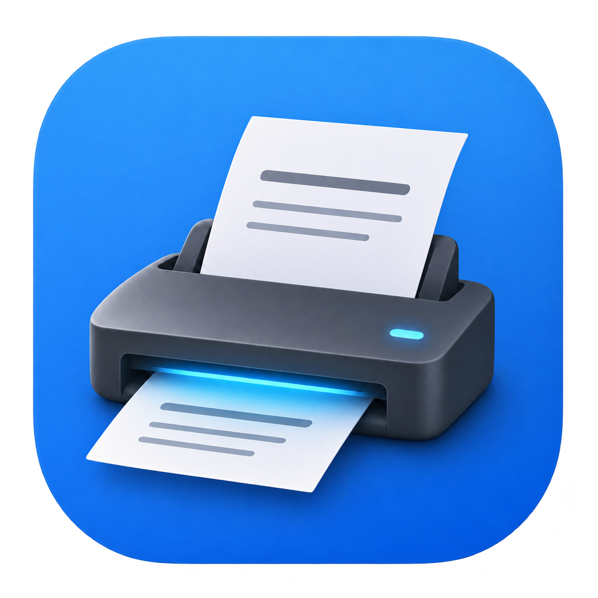

# R3Ds CanonScan

[Deutsch](README.md) · [Download](https://github.com/r3d42-git/R3Ds-CanonScan/releases/latest) · [GPL-3.0-or-later](LICENSE)



A small native macOS document scanning app for the **Canon imageFORMULA P-208II**. Scan, inspect and save high-quality multipage PDFs, optionally searchable using on-device OCR. No Canon software, cloud account or subscription required. **The app interface is currently German.**

## Features

- Scan using the scanner's **hardware Start button** while the document window is active. The current scan settings apply, and additional pages are appended. Disable “Scannertaste verwenden” in scan options if needed. “Scannertaste bereit” indicates readiness; listening pauses during other operations and while the app is in the background.
- Scan single-sided or duplex A4 documents through the automatic feeder. Append additional batches to the same document.
- Switch between **original, enhanced grayscale and black-and-white after scanning** without feeding the paper again. The selected appearance applies to the current document and PDF export.
- Lighten paper backgrounds, reduce background column variation and gently sharpen text. Software black-and-white uses adaptive local thresholding of the grayscale acquisition.
- Remove confidently detected thin feeder edges at the top/bottom; disable per page if needed. Detection is conservative and cannot remove every defect. Original images are retained.
- Rotate, reorder and remove pages, undo the last removal, or start a new scan with confirmation before discarding unsaved pages.
- Inspect full-resolution previews with **fit page, fit width, 100%, 10–800% zoom** and trackpad magnification.
- Export multipage PDFs at the full scan resolution with losslessly compressed page images. Optional **local Apple Vision OCR** adds an invisible text layer for searching and copying in German and English. OCR can be disabled and may contain recognition errors.
- Recover unsaved sessions after relaunch; cancel active operations and receive useful feeder/error feedback.

## Hardware and system

| Requirement | This release |
| --- | --- |
| Mac | Apple Silicon (arm64), **macOS 27.0 or later** |
| Scanner | **Canon imageFORMULA P-208II**, USB `1083:165f` |
| Connection | USB, with the scanner's **Auto Start switch OFF** |
| Paper | A4, 210 × 297 mm; manual rotation after scanning |
| Resolution | 150, 200, 300, 400 or 600 dpi; 300 dpi by default |
| Feeder | Single-sided or duplex ADF; up to 10 sheets per batch according to the hardware specification |

**Physically verified:** P-208II on an M5 Mac running macOS 27.2.1, 300 dpi, multipage duplex acquisition, ordering, background/edge processing, grayscale/black-and-white and PDF export with and without OCR. Preview and zoom were also checked in the running app. A model-specific `duplex-offset 260` setting (approximately 5.5 mm) corrects the observed front/back sensor offset.

Other scanners, including the P-208 without “II”, are **not supported**. Embedded discovery is restricted to the P-208II; this is not a general-purpose SANE frontend. Intel Macs, older macOS releases, other paper sizes, network scanning, automatic crop/deskew, automatic blank-page removal, PDF import and color scanning are outside this release. 600 dpi, a full 10-sheet batch and launch on a clean Mac have not been separately tested on hardware.

## Install and scan

1. Download and extract `R3Ds-CanonScan-…-macOS-arm64.zip` from [Releases](https://github.com/r3d42-git/R3Ds-CanonScan/releases/latest). The app is Developer ID signed, Apple notarized and has its notarization ticket stapled to it.
2. Move **R3Ds CanonScan.app** to Applications and launch it. No Homebrew installation, system SANE installation or Canon driver is needed to use it.
3. Connect the scanner via USB, switch Auto Start off and load the paper straight. Use “Scanner suchen” to search again if needed. If paper does not feed, reseat it and start again.
4. Choose resolution, duplex and OCR in “Scanoptionen”, then “Scannen”. Inspect the appearance/order; “Weitere Seiten” appends more pages and “PDF sichern” exports the PDF.

The [four-page monochrome test document](Resources/Scannertest-4-Seiten.pdf) contains fictional text, page identifiers, fine type and registration marks. Print A4 at **100%**, duplex on the long edge: two sheets should produce four marked pages when scanned duplex.

## Privacy and local files

Scanning and OCR stay on your Mac. The app has no telemetry, uploads, updater or network service of its own; the scanner helper communicates over USB. PDF export writes a temporary file in the destination directory and atomically replaces the destination.

Original page images and recovery metadata live in `~/Library/Application Support/CanonScan/Sessions`. These can contain sensitive documents. Saved or discarded sessions may leave image files there; automatic cleanup is not implemented yet. To remove all retained scan files, quit the app and deliberately delete that folder. The R3Ds CanonScan branding preserves the existing bundle identifier and sessions.

## Build from source

Requires Apple Silicon, macOS 27+, Xcode with Swift 6+ and its command line tools. No global packages are installed automatically.

```sh
./script/build_and_run.sh
./script/build_and_run.sh --build-only
swift test -c release --disable-sandbox
```

The first build downloads pinned, SHA-256-verified sources and a local build tool to compile the embedded `scanimage` helper. Later builds use the local cache. See [backend build details](docs/backend.md) and [third-party notices](THIRD_PARTY_NOTICES.md).

Optional file-only hardware tests use your PNG scans through `CANONSCAN_HARDWARE_FIXTURE`, `CANONSCAN_QUALITY_FIXTURE` and `CANONSCAN_CLIPPED_EDGE_FIXTURE`; they never operate the feeder. Without those variables, the relevant tests are skipped. `script/create_test_pdf.py` regenerates the printable fixture using Python, `reportlab`, `pypdf` and the macOS Arial/Courier New fonts.

See [RELEASING.md](docs/RELEASING.md) for signed/notarized releases. Apple signing credentials are needed only for distribution, not development builds.

## License and independence

Copyright © 2026 R3D. The app source and original icon are licensed under **GNU GPL version 3 or later**, without warranty. Releases also provide complete source archives and the build recipe for the embedded backend components. Each component retains its respective license: [THIRD_PARTY_NOTICES.md](THIRD_PARTY_NOTICES.md).

R3Ds CanonScan is independent, neither provided nor supported by Canon. Canon and imageFORMULA belong to their respective trademark owners; model names identify compatible hardware.
