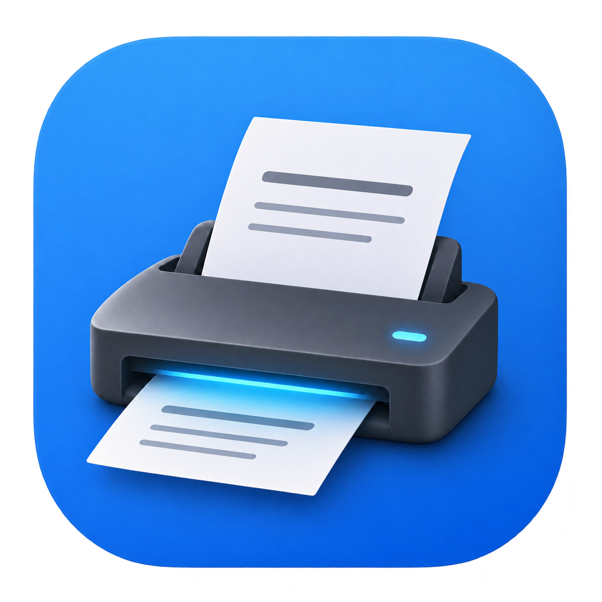

# R3Ds CanonScan

[English](README.en.md) · [Download](https://github.com/r3d42-git/R3Ds-CanonScan/releases/latest) · [GPL-3.0-or-later](LICENSE)



Eine kleine native macOS-App für den **Canon imageFORMULA P-208II**: Dokumente einlesen, Seiten prüfen und als hochwertige, auf Wunsch durchsuchbare PDF speichern. Ohne Canon-Software, Cloudkonto oder Abonnement. Die Oberfläche ist deutsch.

## Funktionen

- Mit der **Starttaste am Scanner** scannen: Bei aktivem Dokumentfenster werden die gewählten Scanoptionen verwendet und weitere Seiten angehängt. Unter „Scanoptionen“ lässt sich „Scannertaste verwenden“ abschalten. „Scannertaste bereit“ zeigt die Bereitschaft an; während anderer Vorgänge und bei inaktiver App pausiert die Taste.
- Mehrseitige A4-Dokumente über den automatischen Einzug scannen, einseitig oder beidseitig. Weitere Stapel an dasselbe Dokument anhängen.
- Nach dem Scan zwischen **Original, optimierten Graustufen und Schwarzweiß** wechseln, ohne erneut einzuziehen. Die Auswahl gilt für das aktuelle Dokument und dessen PDF-Export.
- Papierhintergrund aufhellen, streifige Hintergrundschwankungen reduzieren und Schrift behutsam nachschärfen. Schwarzweiß entsteht durch lokale adaptive Schwellwertberechnung aus dem Graustufenscan.
- Erkannte schmale Einzugskanten am oberen/unteren Rand bereinigen; pro Seite abschaltbar. Das Original bleibt erhalten. Nicht jeder Randfehler wird sicher erkannt.
- Seiten drehen, umordnen, entfernen und das letzte Entfernen widerrufen. „Neuer Scan“ verwirft ein ungesichertes Dokument erst nach Bestätigung.
- Vorschau mit **Einpassen, Seitenbreite, 100 %, Zoom von 10–800 %** und Trackpad-Zoom. Die tatsächliche Auflösung bleibt erhalten.
- Mehrseitige PDFs mit voller Scanauflösung und verlustfrei komprimierten Seitenbildern exportieren. Optional ergänzt **Apple Vision lokal** eine unsichtbare Textebene für Suche und Kopieren (Deutsch und Englisch). OCR ist abschaltbar und kann Erkennungsfehler enthalten.
- Ungesicherte Dokumente nach Neustart wiederherstellen; laufende Vorgänge abbrechen; Fehler und leeren Einzug anzeigen.

## Hardware und System

| Voraussetzung | Unterstützung in diesem Release |
| --- | --- |
| Mac | Apple Silicon (arm64), **macOS 27.0 oder neuer** |
| Scanner | **Canon imageFORMULA P-208II**, USB `1083:165f` |
| Verbindung | USB; **Auto Start am Scanner ausschalten** |
| Format | A4, 210 × 297 mm; manuelle Drehung nach dem Scan |
| Auflösung | 150, 200, 300, 400 und 600 dpi; Standard 300 dpi |
| Einzug | ADF, einseitig oder Duplex; laut Gerätespezifikation bis zu 10 Blatt pro Stapel |

**Am echten Gerät geprüft:** P-208II an einem M5-Mac mit macOS 27.2.1, 300 dpi, mehrseitiger Duplexscan, Reihenfolge, Hintergrund-/Randkorrektur, Graustufen/Schwarzweiß und PDF mit/ohne lokale OCR. Vorschau und Zoom wurden zusätzlich in der App geprüft. Einzugsversatz ist für dieses Modell mit `duplex-offset 260` (rund 5,5 mm) korrigiert.

Andere Modelle — auch der P-208 ohne „II“ — und andere Scanner sind **nicht freigegeben**. Die eingebettete SANE-Konfiguration beschränkt die Erkennung auf den P-208II. Das ist keine allgemeine SANE-Scanneroberfläche. Intel-Macs, ältere macOS-Versionen, andere Papierformate, Netzwerk-Scanner, automatisches Zuschneiden/Geraderichten, automatische Leerseitenentfernung, PDF-Import und Farbscan gehören nicht zu diesem Release. 600 dpi, volle 10-Blatt-Stapel und Betrieb auf einem frischen Mac wurden noch nicht separat am Gerät getestet.

## Installation und erster Scan

1. Das aktuelle `R3Ds-CanonScan-…-macOS-arm64.zip` von den [Releases](https://github.com/r3d42-git/R3Ds-CanonScan/releases/latest) laden und entpacken. Die App ist mit Developer ID signiert, von Apple notarisiert und trägt das angeheftete Notarisierungsticket.
2. **R3Ds CanonScan.app** in „Programme“ ziehen und starten. Homebrew, SANE-Systeminstallation und Canon-Treiber werden zum Benutzen nicht benötigt.
3. Scanner per USB anschließen, Auto Start ausschalten und Papier gerade einlegen. „Scanner suchen“ bei Bedarf erneut anklicken. Wenn der Einzug nicht greift, Papier neu einsetzen und den Scan erneut starten.
4. In den Scanoptionen Auflösung, Duplex und OCR wählen, dann „Scannen“. Darstellung und Reihenfolge prüfen; „Weitere Seiten“ ergänzt den Stapel. „PDF sichern“ öffnet den Speicherdialog.

Die [vierseitige Schwarzweiß-Testvorlage](Resources/Scannertest-4-Seiten.pdf) prüft Duplex, Reihenfolge, Text und Ränder. Auf A4 mit **100 %**, beidseitig an der langen Kante drucken; zwei Blätter ergeben vier eindeutig markierte Scanseiten. Sie enthält nur erfundene Testdaten.

## Datenschutz und lokale Ablage

Scans und OCR bleiben lokal. Die App enthält keine Telemetrie, keinen Upload und keinen eigenen Update- oder Netzwerkdienst. Der Scannerhelfer kommuniziert per USB. Beim Export wird zuerst eine temporäre PDF im Zielordner erstellt und danach atomar an den Zielnamen verschoben.

Die Wiederherstellung speichert originale Scanbilder und Sitzungsdaten unter `~/Library/Application Support/CanonScan/Sessions`. Diese können vertrauliche Dokumente enthalten. Gesicherte oder verworfene Sitzungen können dort weiterhin Bilddateien hinterlassen; automatische Speicherbereinigung gibt es noch nicht. Zum vollständigen Entfernen lokaler Scanreste die App beenden und diesen Ordner bewusst löschen. Die Namensänderung behält Bundle-ID und bestehende Sitzungen bei.

## Selbst bauen

Apple Silicon, macOS 27+, Xcode mit Swift 6+ und Xcode-Kommandozeilenwerkzeuge werden benötigt. Keine globalen Pakete werden automatisch installiert.

```sh
./script/build_and_run.sh
./script/build_and_run.sh --build-only
swift test -c release --disable-sandbox
```

Beim ersten Build lädt das Projekt gepinnte, SHA-256-geprüfte Quellen und ein lokales Buildwerkzeug und erstellt den eingebetteten `scanimage`-Helfer. Weitere Builds verwenden den lokalen Cache. Details: [Backend](docs/backend.md), [Drittanbieter](THIRD_PARTY_NOTICES.md).

Optionale dateibasierte Hardwaretests verwenden eigene PNG-Testscans über `CANONSCAN_HARDWARE_FIXTURE`, `CANONSCAN_QUALITY_FIXTURE` und `CANONSCAN_CLIPPED_EDGE_FIXTURE`; sie starten niemals den Einzug. Ohne diese Variablen werden die betreffenden Tests übersprungen. Die Testvorlage erzeugt `script/create_test_pdf.py` (Python mit `reportlab`, `pypdf` und macOS-Schriften Arial/Courier New).

Eigene signierte Veröffentlichungen: [Releaseablauf](docs/RELEASING.md). Apple-Signaturzugang und ein lokales Notarisierungsprofil sind dafür nötig, zum normalen Bauen nicht.

## Lizenz und Unabhängigkeit

Copyright © 2026 R3D. App-Quellcode und eigenes Icon stehen unter **GNU GPL Version 3 oder neuer**, ohne Gewährleistung. Der Release enthält zusätzlich vollständige Quellen der eingebundenen Backend-Komponenten samt Buildanleitung. Komponenten behalten ihre jeweiligen Lizenzen: [THIRD_PARTY_NOTICES.md](THIRD_PARTY_NOTICES.md).

R3Ds CanonScan ist unabhängig und wird nicht von Canon bereitgestellt oder unterstützt. Canon und imageFORMULA sind Marken ihrer jeweiligen Inhaber; der Modellname beschreibt die unterstützte Hardware.
